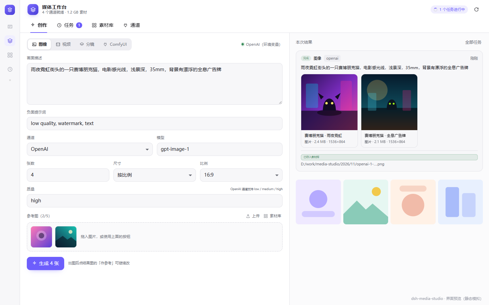

# dsh-media-studio · 媒体工作台

> 一个媒体工作台：云端图像、云端视频与本地 ComfyUI 工作流共用**一张通道表、一条任务队列、一个素材库、一套 Agent 工具、一个面板**。

```text
云端图像（OpenAI / Gemini / 百炼 / 方舟 / xAI）
云端视频（Sora / Veo / Wan / Seedance / Grok）
本机 ComfyUI 工作流（API 格式，变量绑定）
        └──────────┬──────────┘
            统一通道层 channels
                   │
            统一任务层 jobs（异步 / 轮询 / 取消 / 落盘）
                   │
            统一素材层 library（sidecar + 索引 + Range）
                   │
        ┌──────────┴──────────┐
   9 个 Agent 工具        4 页签面板
```



> 上图为界面静态预览（`docs/preview.html`），实际面板跟随 DSH 主题与字号。

---

## 1. 这个插件怎么合

### 1.1 统一通道层

一次配置，三种生产：

```ts
{ id: 'openai',  kind: 'openai',  capabilities: ['image', 'video'] }
{ id: 'google',  kind: 'google',  capabilities: ['image', 'video'] }
{ id: 'ark',     kind: 'ark',     capabilities: ['image', 'video'] }
{ id: 'comfyui', kind: 'comfyui', capabilities: ['image', 'video', 'workflow'] }
```

- 同一套 `ChannelConfig` 覆盖图像、视频、本地工作流；`resolveChannel()` 按能力 + 就绪状态挑通道。
- Key 解析顺序：面板内联 → 环境变量（`OPENAI_API_KEY` 等）；面板只显示掩码。
- 每个协议族一个适配器文件（`src/host/providers/*.ts`），请求形状按各家真实协议整形，不做「一个万能 body」。
- ComfyUI 是通道，不是插件：地址、鉴权头、超时与云端通道同一处配置。

### 1.2 统一任务层

`JobManager` 一个状态机管五类任务：`image / video / comfy / storyboard / concat`。

- 工具默认**立即返回 jobId**，视频渲染几分钟也不阻塞对话；`wait: true` 才同步等。
- 取消、轮询、落盘（`~/.dsh-media-studio/jobs/*.json`）、重启后标记中断，都是同一套。
- 分镜的子状态（每镜 pending/running/done + 产物 id）挂在 `job.shots` 上，面板与工具读同一份。

### 1.3 统一素材层

- 生成物写入 `<工作区>/media-studio/YYYY/MM/`，每个文件旁写 `.meta.json`（提示词、通道、模型、seed、参考图）。
- 中央索引 `library/index.json` 可重建；搜索按提示词/文件名/模型/标签。
- `/api/asset/:id` 支持 **HTTP Range**，视频可拖动进度条；只服务已登记的资产，不做出任意路径的文件出口。
- 本机已有媒体用「登记文件」纳入，不复制；导入受工作区 + `importRoots` 白名单约束。

### 1.4 统一工具面（11 个）

| 工具 | 用途 |
|---|---|
| `media_channels` | 通道清单、能力、就绪状态、ComfyUI 在线状态 |
| `media_generate_image` | 1–10 张、最多 5 张参考图、通道/模型/尺寸/比例/质量 |
| `media_generate_video` | 文生/图生/首尾帧/多参考，按参考图数推断模式 |
| `media_canvas_edit` | 画布编辑：局部重绘（指定位置改图/改元素）与定向扩图 |
| `media_canvas_state` | 读写画布面板状态，实现聊天与画布双向联动 |
| `media_comfy_workflows` | 列/查看本机工作流：变量、图片槽位、输出 |
| `media_comfy_run` | 传 vars + 图片跑工作流，异步或等待 |
| `media_job` | 查/等/取消任务，读每镜状态；`collect` 可对超时的 ComfyUI 任务重新取回产物 |
| `media_library` | 搜索、详情、收藏、删除、登记本机文件 |
| `media_storyboard` | 多镜批量生成，可选尾帧衔接 + 自动拼接 |
| `media_concat` | 本机 ffmpeg 拼两段以上视频，零模型成本 |

工具返回始终包含本地 `path` 与预览 `url`；宿主有 attachment 服务时再附内联图片（失败则静默降级，不影响路径可用）。

### 1.5 统一面板（5 页签）

- **创作**：图像 / 视频 / 分镜 / ComfyUI 四种模式一个表单；参考图可拖入、从素材库选；右侧结果区直接「作参考」再改。
- **画布**：三栏工作室——**左侧历史、中间无限画布、右侧生成面板**。支持文生图与图生图：局部重绘（框选 + 原生 mask）、扩图（**给定目标画布尺寸（底），把原图拖到任意位置，紫色区域即扩图区**）、标注改图（Cowart 式：画红色箭头 + 文字标注，模型读标注生成干净成品图）。**火山方舟 / Seedream 走原生 mask 接口**（`image` + `mask`，白色=重绘区），像素级锁定；其他通道用白色软遮罩 + 参考图编辑兜底。画布可拖拽平移、滚轮缩放、适应窗口，结果可「设为底图」继续迭代。**与聊天双向联动**：画布状态实时同步到宿主，聊天里可用 `media_canvas_state` 读写（读当前底图/目标底/标注，或把结果推回画布）。
- **ComfyUI 工作流**：支持**上传 `.json` 文件**（按钮或拖入窗口）或直接粘贴 API 格式 JSON；UI 格式会当场提示重新导出。已配置的 ComfyUI 也会出现在图像/视频的通道下拉里，选中即切到工作流模式。没有 KSampler 的视频工作流（如 MiniMax H3 / WAN）也能从 conditioning 的 `prompt` 或标题为 Prompt/Text 的字符串节点识别出提示词；H3 的 `length` 会按 24fps 的 `5 + 17k` 规则在「秒」与「帧」之间转换，seed 与尺寸也会暴露；模板自带图片的槽位是可选的。
- **任务**：全部异步任务、状态、进度、取消、产物。
- **素材库**：搜索 / 图片视频筛选 / 收藏 / 详情 / 下载 / 多选视频拼接 / 登记本机文件。
- **通道**：通道增删改测、默认通道、输出目录、ffmpeg 路径、导入白名单、ComfyUI 工作流启停。展开通道时自动从上游 `/models` 拉取模型列表（图像/视频自动分类，失败回退内置目录），也可手动「重新拉取」。

## 2. 安装

要求：DeepSeek Harness（Web / Desktop 均可），Node.js ≥ 20。

```bash
# 本地开发（把路径换成你的 clone 目录）
dsh plugin --profile desktop add link:D:/path/to/dsh-media-studio

# GitHub 直装
dsh plugin --profile desktop add github:wustar1109/dsh-media-studio

# 或从 Release 资产装入（带 SHA256SUMS）
dsh plugin --profile desktop add https://github.com/wustar1109/dsh-media-studio/releases/download/v0.4.4/dsh-media-studio-0.4.4.tgz
```

装完重启 DSH，左侧栏出现「媒体工作台」图标；主界面也会多一个同名面板。若宿主版本较老，入口在「设置 → 插件 → 已安装」。

> 不装 `@deepseek-ai/*` 运行时依赖：工具、HTTP、附件都通过 `ctx.get(...)` 取，`link:` 安装与 tarball 安装都不会因为物理路径不同而解析失败。

## 3. 配置

打开面板「通道」页：

1. 选一个通道，填 **API Key**（或填环境变量名，如 `OPENAI_API_KEY`）。
2. 确认 **baseUrl** 与 **默认模型**；点「测试连接」。
3. 在「默认通道」里选图像/视频的默认项。
4. ComfyUI：在面板里填写 ComfyUI 的根地址（仓库不内置任何地址）；`comfyui` 通道无需 Key。

配置写在 `~/.dsh-media-studio/config.json`，Key 在面板上只显示掩码；也可以用环境变量完全不给面板。

| 字段 | 默认 | 说明 |
|---|---|---|
| `outputDir` | `<工作区>/media-studio` | 生成物落盘根 |
| `ffmpegPath` | 自动探测 | 分镜衔接 / 拼接需要 |
| `importRoots` | `[]` | 允许登记/读取的额外目录 |
| `maxImageBytes` / `maxVideoBytes` | 40 MB / 512 MB | 下载上限 |
| `videoTimeoutMs` | 40 min | 单条视频轮询上限 |
| `comfyTimeoutMs` | 60 min | 单次工作流等待上限；超时后可在任务页「重新收集产物」 |

## 4. HTTP API

前缀 `/media-studio/api`（同源，仅本机）：

```text
GET  /config                POST /config
GET  /channels              POST /channels/test
GET  /jobs                  GET/DELETE /jobs/:id   POST /jobs/:id/cancel
POST /generate/image        POST /generate/video
POST /storyboard            POST /concat
GET  /comfy/workflows       POST /comfy/import     POST /comfy/run
POST /comfy/workflows/:id   DELETE /comfy/workflows/:id
GET  /library               POST /library/scan     POST /library/import
POST /library/:id/favorite  DELETE /library/:id
GET  /asset/:id             GET /stats
```

## 5. 开发

```bash
pnpm install
pnpm run typecheck   # tsc --noEmit
pnpm run build       # lib/index.js + lib/client.js
pnpm test            # host / comfy / render 三组冒烟
```

- 宿主产物：单文件 ESM，`node:*` 外部化。
- 客户端产物：CJS 由 `window.__ModuleLoader__.load` 包成 factory，React 由宿主注入；CSS 以文本打包后 `<style>` 注入。
- 构建脚本调用 esbuild **CLI** 并继承 stdio，避开部分沙箱里 `child_process` 管道 EPERM 的问题。

## 6. 边界与安全

- **密钥**：只存本机 `~/.dsh-media-studio/config.json`；面板读取时掩码；工具结果与日志经过 `redact()`。
- **文件**：只服务素材库登记过的 id；登记/读取路径必须在工作区、输出目录或 `importRoots` 内（realpath + 大小写折叠比较）。
- **取消**：只取消本机等待/轮询；云端已提交的渲染可能继续计费。
- **ComfyUI**：不自动拉起进程、不 kill 用户实例——拉模型时被杀是事故。离线直接报错，不做「假装排队」。
- **ffmpeg**：纯本地、不联网、不消耗额度；找不到二进制时明确提示路径配置。

## 7. 这一版没做什么

诚实清单（不是漏了，是刻意留到下一版）：

- **无限画布 / 节点图**：分镜 + 拼接覆盖了「按序生成、接尾帧、出成片」的主路径，节点图是另一个量级的编辑器。数据模型（job + shots + assets）已经能承接画布层。
- **订阅账号登录**（ChatGPT / Grok / Google）：需要各家 OAuth 与凭证服务，且与 API Key 通道是两套凭据模型。
- **Danbooru 本地大库 / 姿势库 / 衣装库**：172MB 常驻索引与图床代理是独立工程；当前只保留工作流执行与素材管理。
- **电商套图 / 图片转 PPT / 代码渲染**：垂直工作流，依赖各自的模板与技能系统。
- **云端真取消、精确进度百分比**：上游没有稳定接口，就只显示阶段文案。

## 8. 许可与致谢

本项目以 **Apache-2.0** 发布。设计参考并在部分实现上改写自：

- [dsh-comfyui-workbench](https://github.com/YuChenLiao/dsh-comfyui-workbench)（MIT）——工作流 IO 面推断、变量绑定、资产 sidecar/index、基于 `ctx.get` 的无依赖宿主接入。
- [dsh-image-gen](https://github.com/shanliuling/dsh-image-gen)（Apache-2.0）——多厂商图像请求形状、参考图解析、通道就绪判定。
- [dsh-imagegen-video](https://github.com/q253595422/dsh-imagegen-video)（Apache-2.0）——视频任务提交/轮询/下载的协议族形状、分镜衔接与 ffmpeg 拼接思路。

详见 [NOTICE](NOTICE)。上述上游项目的版权归各自作者所有；本仓库没有直接打包它们的代码或数据文件。
